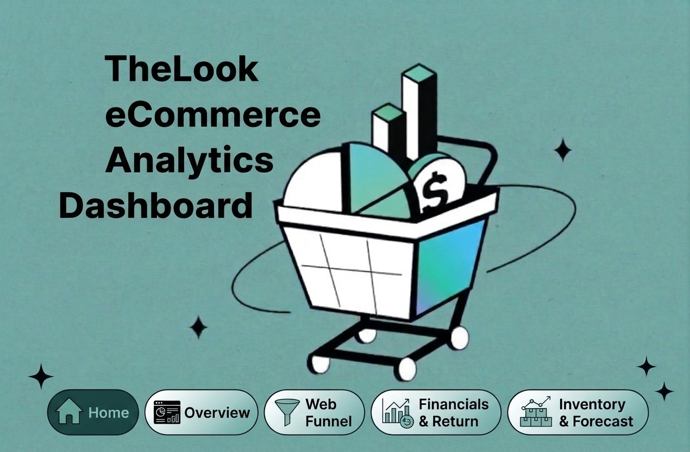
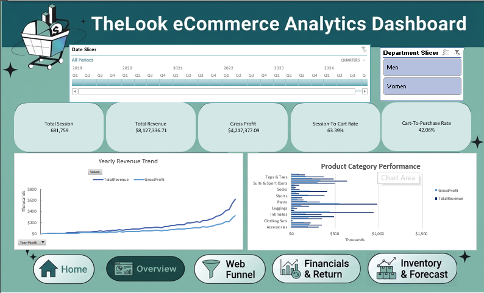

I'm happy to share my latest project: "TheLook eCommerce Dashboard" 
I worked on this project as part of my data analysis learning journey, using Excel and Power Query to explore e-commerce data and turn it into something easier to understand.
Here’s what I worked on:

- Cleaning and transforming data using Power Query.
- Building a data model and connecting multiple tables.
- Creating KPIs to track revenue, profit, and returns.
- Building interactive dashboards with PivotTables, Slicers, and a monthly revenue forecast.
This project gave me a chance to put different skills into practice and understand how raw data can be turned into useful business insights.

I'd appreciate any feedback or suggestions

## Dashboard Previews

### 1. Home Page

### 2. Overview Dashboard

### 3. Web Funnel Analysis

### 4. Financials & Return

### 5. Inventory & Forecast

